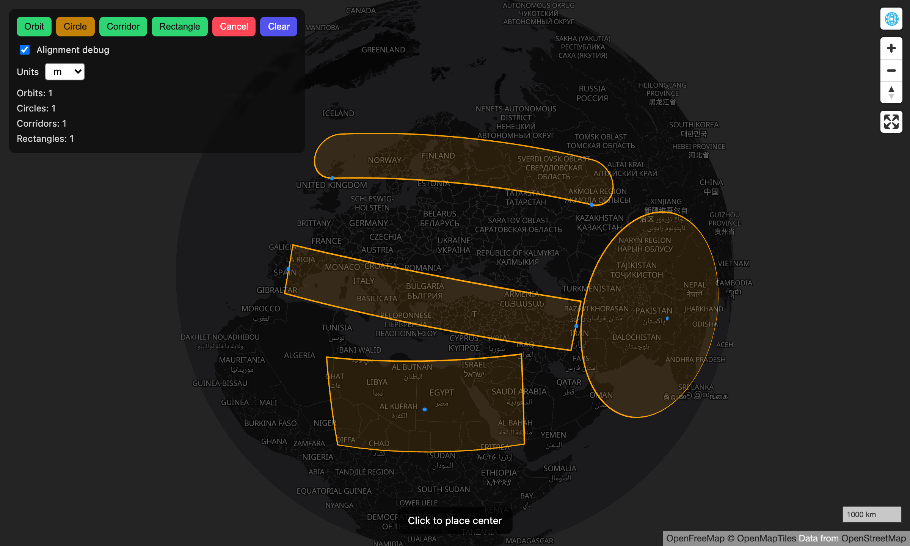
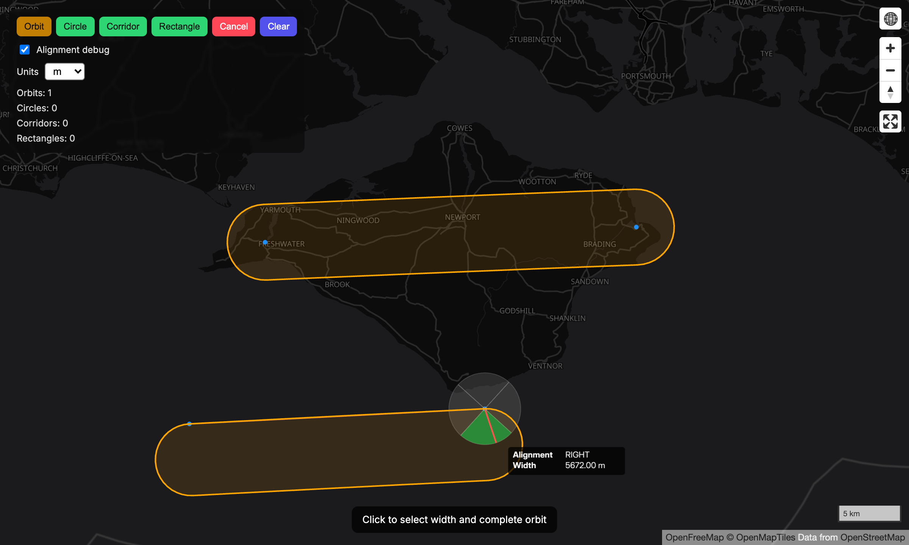
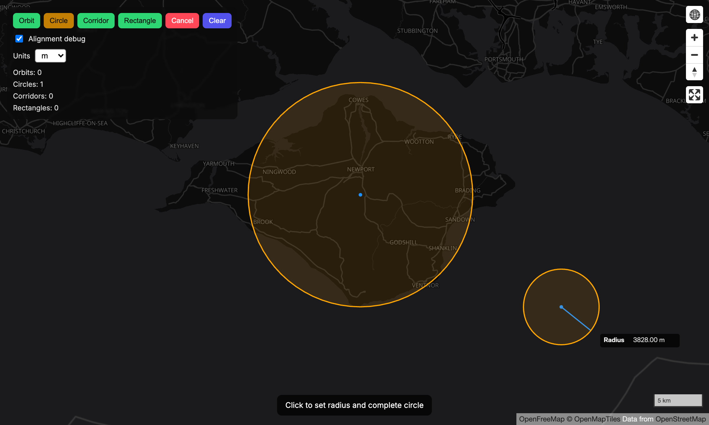
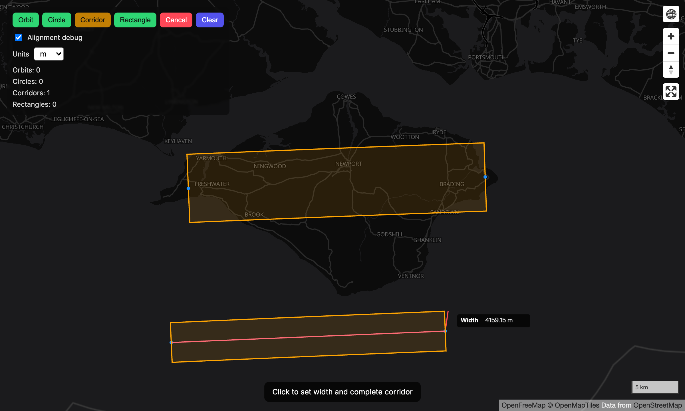
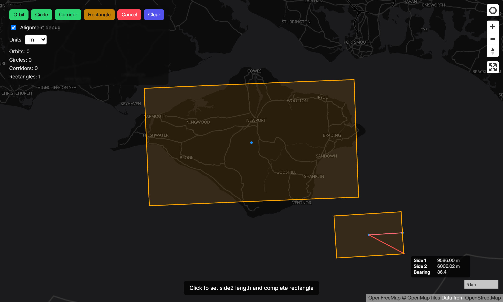

# @eknowles/deck-gl

Framework-agnostic geometry editing toolkit for Deck.GL apps.
Core package stays React-free. React package adds thin hooks only.



**Breaking (0.x):** Removed `EditorStateManager`, `useOrbitAreaEditor`, `OrbitAreaEditorControls`, composite `OrbitAreaEditor` layer, and `src/layers/orbit`. Use `OrbitAreaMode` + `OrbitAreaModeLayer` + `useOrbitAreaMode`, or `createMode("orbit", …)` from the mode registry.

## Install

```bash
npm install @eknowles/deck-gl
```

## Package Entry Points

- `@eknowles/deck-gl/core`: framework-agnostic modes, layers, types, utils
- `@eknowles/deck-gl/react`: React hooks/adapters only
- `@eknowles/deck-gl/orbit`: convenience aggregate exports for orbit/circle workflows
- `@eknowles/deck-gl`: root aggregate (backward compatibility)

## Current Geometries

All geometries use great-circle calculations. Shapes keep their form over long distances and on a globe.

| OrbitArea | Circle |
| --- | --- |
|  |  |
| Two axis points, then a width. The width click sets the alignment (left, centre or right). | A centre point, then a radius. |

| CorridorArea | RectangleByCentre |
| --- | --- |
|  |  |
| Two centreline points, then a width. | A centre point, then the first side and bearing, then the second side. |

Planned next: Ellipse, PolygonArea.

## Mode-First API

Each geometry mode follows same lifecycle:

- `handleClick(info)`
- `handleHover(info)`
- `reset()`
- `getState()`
- `getStep()`
- `on("change" | "complete", callback)`

This keeps geometry logic pluggable and consistent across modes.

`OrbitAreaModeLayer` accepts **`debug?: boolean`** (default `false`). When `true`, during the width step it draws **bearing-relative quadrant wedges** at the second axis point so you can verify alignment math (same idea as the old `AlignmentDebugShaderLayer`).

## Core Usage (No React)

```ts
import { OrbitAreaMode, OrbitAreaModeLayer, OrbitAreaLayer } from "@eknowles/deck-gl/core";

const mode = new OrbitAreaMode();
mode.on("complete", (orbitArea) => {
  // persist orbitArea
});
```

## React Usage

```tsx
import { useOrbitAreaMode } from "@eknowles/deck-gl/react";
import { OrbitAreaModeLayer, OrbitAreaLayer } from "@eknowles/deck-gl/core";

const orbitMode = useOrbitAreaMode((orbitArea) => {
  setOrbitAreas((prev) => [...prev, orbitArea]);
});
```

## Mode registry

Register custom modes or replace built-ins (`orbit`, `circle`):

```ts
import {
  registerMode,
  createMode,
  listRegisteredModeIds,
} from "@eknowles/deck-gl/core";

listRegisteredModeIds(); // ["orbit", "circle"]

const mode = createMode("orbit", { distanceUnit: DistanceUnit.NAUTICAL_MILES });
mode?.on("complete", (feature) => {
  /* OrbitArea */
});
```

## Development

```bash
bun install
bun run dev
bun run build
```

## License

MIT


